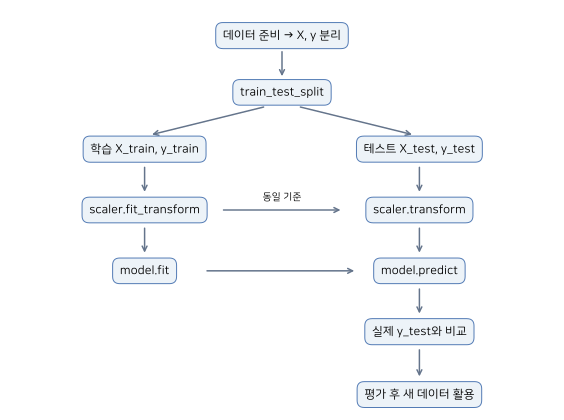
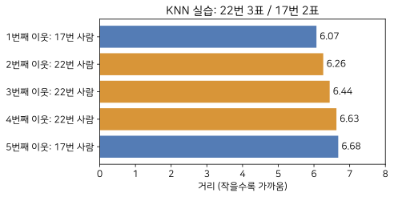
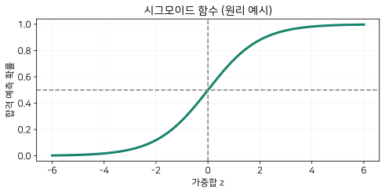
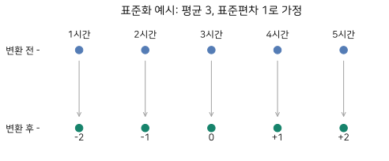
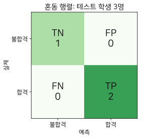

# 2026-11-27 TIL Day 25 — KNN 복습과 로지스틱 회귀

## 1. 오늘의 학습 내용과 전체 흐름

- KNN 얼굴 이미지 분류 수정: 배열 차원, 마스킹, 이웃 인덱스, 모델 평가
- 로지스틱 회귀: 학생 합격 여부와 확률 예측
- 학습/테스트 분리, 표준화, 학습, 예측 및 혼동 행렬



모델마다 판단 원리는 다르지만 scikit-learn의 기본 사용 방식은 비슷하다. 데이터를 준비하고, 입력과 정답을 나누고, 학습용과 테스트용으로 분리한 후 필요한 전처리를 한다. 학습용 데이터로 모델을 학습하고, 보지 못한 테스트 데이터로 예측한 뒤 실제 정답과 비교한다. 평가가 끝난 모델은 새로운 데이터에 활용한다. 오늘 실습에서는 새 학생 예측을 먼저 수행했지만 위 그림은 일반적인 개발 흐름이다.

| 구분 | 선형회귀 | KNN 분류 | 로지스틱 회귀 |
|---|---|---|---|
| 목적 | 연속 수치 예측 | 범주 분류 | 범주 및 확률 예측 |
| 학습 원리 | 계수와 절편 결정 | 기존 데이터 등록 및 탐색 준비 | 분류 계수와 절편 결정 |
| 실습 | 다이아몬드 가격 | 얼굴 사람 번호 | 학생 합격 여부 |
| 평가 | MSE, R² | 정확도 | 정확도, 혼동 행렬 |

**지도학습(Supervised Learning)**: 정답이 있는 데이터로 학습하는 방식. 회귀(Regression)는 연속적인 숫자를, 분류(Classification)는 정해진 범주를 예측한다. 로지스틱 회귀는 이름과 달리 분류에 사용한다. 이진 분류는 범주 두 개, 다중 클래스 분류는 세 개 이상의 범주를 구분하는 문제이다.

## 2. KNN 수정 및 복습

### 2-1. 이미지 데이터 구조

```python
import numpy as np
import matplotlib.pyplot as plt
from sklearn.datasets import fetch_olivetti_faces

faces = fetch_olivetti_faces(data_home="./datasets")
print(faces.images.shape)
print(faces.data.shape)
print(faces.target.shape)
print(np.unique(faces.target))
```

| 속성 | shape | 의미 |
|---|---|---|
| `faces.images` | (400, 64, 64) | 400장, 각각 64×64 픽셀 |
| `faces.data` | (400, 4096) | 사진마다 픽셀 4096개를 한 행으로 펼침 |
| `faces.target` | (400,) | 각 사진의 사람 번호 |

`data_home`은 데이터 저장 위치이다. `np.unique()`는 중복을 제거한 고유값을 반환한다(0~39). 픽셀은 밝기를 나타내는 숫자로, 여기서는 0에 가까우면 검고 1에 가까우면 밝다. 머신러닝의 입력은 일반적으로 (샘플 수, 특성 수) 형태이므로 사진을 한 행으로 펼친 `faces.data`를 사용한다. `reshape(64, 64)`는 값 자체를 바꾸지 않고 다시 사진 모양으로 배열한다.

### 2-2. 픽셀 영역 추출

```python
corner = faces.images[0][20:28, 20:28]
print(corner.min())
print(corner.max())

fig, ax = plt.subplots(figsize=(5, 5))
ax.imshow(corner, cmap="gray", vmin=0, vmax=1)
for r in range(8):
    for c in range(8):
        v = corner[r, c]
        ax.text(c, r, f"{v:.2f}", ha="center", va="center")
plt.show()
```

`[20:28, 20:28]`은 행과 열 각각 20~27번을 추출하므로 (8, 8) 배열을 반환한다. 결과의 최솟값은 0.5371901, 최댓값은 0.71900827이다. `corner` 자체가 배열이므로 `corner.images.max()`가 아니라 `corner.max()`를 사용한다. `ax.text(c, r, ...)`는 그래프의 x좌표(열), y좌표(행)에 값을 표시한다. 가운데 정렬 옵션은 가독성을 위해 추가했다.

### 2-3. 사람별 사진 출력과 대표 사진 선택

```python
def show_person(person):
    pics = faces.images[faces.target == person]
    fig, axes = plt.subplots(1, 10, figsize=(15, 2))
    for ax, img in zip(axes, pics):
        ax.imshow(img, cmap="gray", vmin=0, vmax=1)
        ax.axis("off")
    plt.show()

show_person(0)
show_person(7)

fig, axes = plt.subplots(4, 10, figsize=(15, 8))
for person, ax in enumerate(axes.flat):
    first = faces.images[faces.target == person][0]
    ax.imshow(first, cmap="gray", vmin=0, vmax=1)
    ax.set_title(person, fontsize=10)
    ax.axis("off")
plt.show()
```

`zip()`은 그래프 공간과 사진을 하나씩 짝짓는다. `axes.flat`은 4×10 배열을 차례로 순회하며 `enumerate()`는 번호와 객체를 함께 반환한다. 조건 필터링만 하면 한 사람의 사진 10장 `(10, 64, 64)`이 나오므로 마지막 `[0]`으로 사진 한 장 `(64, 64)`을 선택해야 `imshow()`로 표시할 수 있다. `cmap`은 색상표, `vmin`과 `vmax`는 밝기 표현 범위이다.

### 2-4. KNN 학습과 새로운 사진 예측

KNN(K-Nearest Neighbors, K-최근접 이웃)은 새로운 데이터와 가까운 K개 데이터를 찾아 기본적으로 다수결로 분류한다. 기본 거리 설정에서는 유클리드 거리(각 특성 차이의 제곱합의 제곱근)를 사용한다.

```python
from sklearn.neighbors import KNeighborsClassifier

X = faces.data
y = faces.target
new_index = 229
new_photo = X[new_index]
known = np.arange(400) != new_index
X_known, y_known = X[known], y[known]
K = 5
model = KNeighborsClassifier(n_neighbors=K)
model.fit(X_known, y_known)
dist, idx = model.kneighbors([new_photo], n_neighbors=K)
print("이웃:", y_known[idx[0]])
print("거리:", dist[0].round(2))
pred = model.predict([new_photo])
print("예측:", pred[0])
print("실제:", y[new_index])
```

`np.arange(400)`은 0~399를 생성한다. `known`은 229번만 False인 불리언 배열이다. 마스킹(Boolean Indexing)으로 테스트 사진을 제외한 399장을 학습에 사용한다. 제외하지 않으면 자기 자신이 이웃에 포함되어 새로운 사진을 맞힐 능력을 확인하기 어렵다. `[new_photo]`는 (4096,)인 사진 한 장을 모델이 요구하는 (1, 4096) 구조로 전달한다.

`fit()`은 KNN에서 이웃 탐색에 사용할 데이터를 등록한다. `kneighbors()`는 거리와 학습 데이터 내부 인덱스를 반환한다. `idx` 자체는 사람 번호가 아니므로 `y_known[idx[0]]`으로 정답을 조회한다.



실습 결과: 이웃은 `[17, 22, 22, 22, 17]`, 예측과 실제 정답 모두 22번이다. 거리 순서로 가장 가까운 한 장은 17번이지만 5개 중 22번이 3개이므로 22번으로 분류한다.

```python
for i in range(K):
    j = idx[0][i]
    plt.figure(figsize=(1, 1))
    plt.imshow(X_known[j].reshape(64, 64), cmap="gray")
    plt.title(f"Person {y_known[j]}")
    plt.axis("off")
    plt.show()
```

### 2-5. 전체 모델 평가

```python
from sklearn.model_selection import train_test_split

X_train, X_test, y_train, y_test = train_test_split(
    faces.data, faces.target, test_size=0.25,
    random_state=42, stratify=faces.target
)
model = KNeighborsClassifier(n_neighbors=K)
model.fit(X_train, y_train)
accuracy = model.score(X_test, y_test)
print(f"예측 정확도: {accuracy:.2%}")
```

학습 300장, 테스트 100장. 실습 기록상 정확도 87% (87장 정답, 13장 오답).

### 2-6. 수정 사항 정리

| 기존 표현 | 수정 및 이유 |
|---|---|
| `faces.targer` | `faces.target` 오타 수정 |
| 펼친 사진 크기 | `faces.data.shape` |
| `corner.images.max()` | `corner.max()` |
| 대표 사진 선택 시 `[0]` 누락 | 사진 한 장 선택 |
| 339장이라는 주석 | 실제 399장 |
| `np.unique()` 중복값 조회 | 중복 제거 후 고유값 반환 |
| `idx[0]`은 사람 번호 | 실제로는 학습 배열 인덱스 |
| `plt.show` | `plt.show()` 함수 호출 |

## 3. 로지스틱 회귀의 원리

로지스틱 회귀는 입력 특성의 가중합을 계산하고 시그모이드 함수로 0~1 사이 확률로 바꾼다. 선형회귀는 연속적인 숫자를 예측하지만 로지스틱 회귀는 계산한 확률에 따라 범주를 결정한다.

$$z=w_1x_1+w_2x_2+w_3x_3+b$$
$$p=\frac{1}{1+e^{-z}}$$

- x: 입력 특성(이번 실습에서는 표준화된 값), w: 가중치, b: 절편, z: 확률 변환 전 값
- e: 자연상수 약 2.718, p: 합격 예측 확률
- 시그모이드(Sigmoid): 실수 입력을 0과 1 사이로 변환하는 S자 함수
- 임계값(Threshold): 분류를 결정하는 기준. 기본 이진 분류에서는 0.5보다 높으면 양성(합격), 낮으면 음성(불합격)으로 판단한다. 정확히 0.5인 경우 이 실습의 scikit-learn 모델은 첫 번째 클래스(False)를 선택한다.



위 공식은 원리 설명용이며 오늘 직접 구현한 것이 아니라 `LogisticRegression` 내부에서 처리되는 내용이다. 예: z=0이면 p=0.5, z가 커지면 합격 확률이 높아진다.

## 4. 실습 1 — 데이터 준비 및 X, y 분리

```python
import pandas as pd

df = pd.DataFrame({
    "study_hours":    [1, 2, 3, 4, 5, 2, 3, 5, 4, 1],
    "sleep_hours":    [6, 8, 5, 7, 8, 5, 8, 6, 6, 8],
    "practice_count": [10, 15, 20, 25, 30, 12, 28, 22, 32, 8],
    "score":          [47, 58, 60, 76, 87, 49, 73, 77, 79, 52],
})
X = df[["study_hours", "sleep_hours", "practice_count"]]
y = df["score"] >= 60
print(df[["score"]].assign(passed=y).head())
```

| 용어 | 뜻 |
|---|---|
| Feature | 특성: 예측에 사용할 정보, X의 각 열 |
| Target / Label | 목표변수 / 각 샘플의 정답 |
| Sample | 샘플: 학생 한 명의 데이터 |
| Class | 분류 범주: True(합격), False(불합격) |

X는 (10, 3), y는 (10,)이다. score는 정답을 만드는 데 사용하지만 X에 포함하지 않는다. 미래 학생의 점수는 예측 시점에 알 수 없기 때문이다. 정답 관련 정보를 입력에 포함하는 것은 데이터 누수(Data Leakage)의 한 유형이다.

`assign(passed=y)`는 passed 열을 추가한 새 DataFrame을 반환한다. 원본 df를 직접 수정하지 않는다. 실제 정답은 합격 6명, 불합격 4명이다.

## 5. 실습 2 — 학습/테스트 분리

```python
from sklearn.model_selection import train_test_split

X_train, X_test, y_train, y_test = train_test_split(
    X, y, test_size=0.3, random_state=42, stratify=y
)
```

| 반환값 | 크기 | 역할 |
|---|---|---|
| X_train | (7, 3) | 공부할 문제 |
| y_train | (7,) | 공부할 문제의 정답 |
| X_test | (3, 3) | 시험 문제 |
| y_test | (3,) | 채점용 정답 |

`test_size=0.3`: 30% 테스트 분리. `random_state=42`: 무작위 분리 결과의 재현성을 위한 기준값. 42 자체에 특별한 계산 의미는 없다. `stratify=y`: 정답 범주 비율을 가능한 비슷하게 유지하는 계층적 분할. 전체 합격 6/10, 학습 4/7, 테스트 2/3이다. X와 y를 함께 전달해야 각 학생의 입력과 정답이 어긋나지 않는다.

**왜 분리하는가?** 이미 공부한 문제를 다시 맞히는 것과 처음 보는 문제를 맞히는 것은 다르다. 일반화(Generalization)는 처음 보는 데이터에도 잘 예측하는 능력이고, 과적합(Overfitting)은 학습 데이터에 지나치게 맞추어 새로운 데이터에서 성능이 떨어지는 현상이다.

## 6. 실습 3 — 표준화(Standardization) ★ 중요

공부 시간은 1~5, 수면 시간은 5~8, 문제 풀이 횟수는 8~32로 단위와 숫자 범위가 다르다. 거리 기반 모델에서는 범위가 큰 특성이 거리 계산을 지배할 수 있고, 로지스틱 회귀에서는 최적화 및 규제에 영향을 준다. 표준화는 각 특성의 평균을 0, 표준편차를 1로 맞추는 변환이다(상수 열은 예외). 모든 모델에서 반드시 필요한 것은 아니다.

$$z=\frac{x-\mu}{\sigma}$$

x는 원래 값, μ는 학습 데이터의 해당 열 평균, σ는 해당 열 표준편차이다. 표준편차는 값들이 평균 주변에 얼마나 퍼져 있는지 나타낸다.



평균 3시간, 표준편차 1시간으로 가정하면 4시간은 (4-3)/1=1로 변환된다. 표준화 결과에 시간 단위는 없으며 평균보다 표준편차 1개만큼 높다는 의미이다.

```python
from sklearn.preprocessing import StandardScaler

scaler = StandardScaler()
X_train_scaled = scaler.fit_transform(X_train)
X_test_scaled = scaler.transform(X_test)
print(X_train.iloc[0, 0])
print(X_train_scaled[0, 0])
```

| 메서드 | 역할 |
|---|---|
| `scaler.fit(X_train)` | 각 열의 평균과 표준편차 계산 및 저장 |
| `scaler.transform(X_train)` | 저장한 기준으로 변환 |
| `scaler.fit_transform(X_train)` | 위 두 작업을 한 번에 실행 |

**왜 테스트 데이터에 fit_transform을 쓰지 않는가?** 학습 기준 평균 3, 표준편차 1이면 4시간은 1이다. 테스트 자체 평균 5, 표준편차 1로 다시 계산하면 같은 4시간이 -1이 된다. 모델이 학습한 척도와 달라지고 scaler의 기존 기준도 덮어쓴다. 전체 데이터로 먼저 기준을 학습하면 테스트 정보가 학습에 들어가는 데이터 누수도 발생한다. 따라서 먼저 분리하고 학습 데이터로만 fit하며 테스트와 새 데이터에는 transform만 사용한다.

`X_train`은 DataFrame이므로 `.iloc[행, 열]`, 변환 결과는 기본적으로 NumPy 배열이므로 `[행, 열]`로 접근한다. 수업 기록의 첫 공부 시간은 4시간, 표준화 값은 1.21이다. 표준화 출력 뒤에 붙은 '시간' 단위는 제거하는 것이 맞다.

## 7. 실습 4 — 모델 학습

```python
from sklearn.linear_model import LogisticRegression

model = LogisticRegression(max_iter=1000)
model.fit(X_train_scaled, y_train)
print("클래스:", model.classes_.tolist())
print("가중치:", model.coef_[0].round(3))
```

객체 생성만으로는 아직 학습하지 않는다. `fit()`이 입력과 정답의 관계를 학습하여 가중치와 절편을 결정한다. `max_iter=1000`은 최적화 최대 반복 횟수이며 반드시 1000번 반복한다는 뜻은 아니다.

| 용어 | 의미 |
|---|---|
| Optimization | 최적화: 적절한 계수를 찾는 과정 |
| Loss | 손실: 예측이 정답에 얼마나 잘 맞지 않는지 나타내는 값 |
| Iteration | 반복 |
| Convergence | 수렴: 최적화가 종료 기준에 도달하는 것 |
| Regularization | 규제: 과도하게 큰 계수 등을 억제하는 방법 |

로지스틱 회귀는 일반적으로 로그 손실을 기반으로 학습하며 기본 설정에서는 규제도 사용한다. 이는 원리 보충 설명이다.

실습 출력: classes = `[False, True]`, coef = `[0.873, -0.370, 0.877]`.

`classes_`는 정답 범주 및 확률 열의 순서, `coef_`는 학습된 계수이다. 이진 분류에서는 이번 계수 배열이 (1, 3)이므로 `[0]`으로 첫 행을 선택한다. `tolist()`는 배열을 리스트로, `round(3)`은 소수점 셋째 자리까지 반올림한다.

| 특성 | 계수 | 해석 |
|---|---:|---|
| 공부 시간 | 0.873 | 합격 방향 |
| 수면 시간 | -0.370 | 불합격 방향 |
| 문제 풀이 횟수 | 0.877 | 합격 방향 |

다른 특성이 같을 때 표준화 값 1 증가에 대한 계수이며 확률이 87.3% 증가한다는 뜻은 아니다. 학생 7명에서 학습한 관계이므로 수면 시간이 실제로 합격 가능성을 낮춘다는 인과관계를 증명하지 않는다.

## 8. 실습 5 — 새로운 학생 예측

```python
new = pd.DataFrame([[4, 7, 30]], columns=X.columns)
new_scaled = scaler.transform(new)
predict = model.predict(new_scaled)[0]
pass_proba = model.predict_proba(new_scaled)[0, 1]
print("예측결과:", "합격" if predict else "불합격")
print(f"합격 확률: {pass_proba:.2%}")
```

`columns=X.columns`는 학습 입력과 동일한 열 이름 및 순서를 사용한다. `[[4,7,30]]`은 학생 한 명, 특성 세 개의 2차원 구조이다. `transform(new)`으로 기존 학습 기준을 적용한다. 새 학생 한 명에 fit_transform을 사용하면 모든 표준화 값이 0이 되고 기존 기준도 사라진다.

| 메서드 | 반환 예시 | 의미 |
|---|---|---|
| `predict(new_scaled)` | `[True]` | 학생별 예측 범주 |
| `predict_proba(new_scaled)` | `[[0.0742, 0.9258]]` | 학생별 클래스 확률(근사) |

`[0, 1]`은 0번 학생의 1번 클래스 확률을 선택한다. `classes_=[False, True]`이므로 0번 열은 불합격, 1번 열은 합격이다. 항상 1번 열이 원하는 클래스라고 가정하면 안 된다.

수업 기록 결과: 합격, 합격 확률 92.58%. 실제 합격 확률이 검증되었다는 의미는 아니다.

## 9. 실습 6 — 모델 평가

```python
from sklearn.metrics import accuracy_score, confusion_matrix

test_pred = model.predict(X_test_scaled)
print("실제 정답:", y_test.tolist())
print("예측 결과:", test_pred.tolist())
print(f"정확도: {accuracy_score(y_test, test_pred):.4%}")
print(confusion_matrix(y_test, test_pred, labels=[False, True]))
```

실제 및 예측 모두 `[False, True, True]`이다. 정확도(Accuracy)는 맞힌 개수 / 전체 개수 = 3/3 = 100%이다. `accuracy_score`는 실제 정답과 예측값을 입력받는다. KNN과 로지스틱 회귀의 `model.score()`는 기본적으로 정확도를 반환하지만 선형회귀의 `score()`는 R²(결정계수)를 반환한다.

혼동 행렬(Confusion Matrix)은 실제 범주를 행, 예측 범주를 열로 배치해 맞힌 것과 틀린 것을 구분한다. `labels`는 행과 열 순서를 지정한다.



| 약어 | 영문 | 의미 |
|---|---|---|
| TN | True Negative | 실제 불합격 → 불합격 예측 |
| FP | False Positive | 실제 불합격 → 합격 예측 |
| FN | False Negative | 실제 합격 → 불합격 예측 |
| TP | True Positive | 실제 합격 → 합격 예측 |

정확도 = (TN + TP) / 전체. 대각선이 맞힌 개수이다. TP 등 약어는 혼동 행렬 이해를 위한 보충 설명이다. 테스트 학생이 단 3명이라 정확도 100%만으로 완벽한 모델이라고 판단할 수 없다.

## 10. 공통 코드 구조 — 가장 중요한 복습

| 단계 | 코드 | 역할 및 결과 |
|---|---|---|
| 문제·정답 정의 | `X`, `y` | 모델에게 무엇을 주고 무엇을 맞히게 할지 결정 |
| 분리 | `train_test_split()` | 학습 문제와 시험 문제 구분 |
| 전처리 기준 생성 | `scaler.fit_transform(X_train)` | 학습 기준 저장 및 적용 |
| 전처리 기준 사용 | `scaler.transform(X_test)` | 시험 문제에 동일 기준 적용 |
| 모델 생성 | `LogisticRegression()` | 학습 전 객체 |
| 모델 학습 | `model.fit(X_train_scaled, y_train)` | 예측 규칙 학습 |
| 예측 | `model.predict(X_test_scaled)` | 학습된 규칙으로 시험 문제 풀기 |
| 평가 | `accuracy_score(y_test, test_pred)` | 실제 정답과 비교 |
| 실제 활용 | `scaler.transform(new)` → `model.predict()` | 새 문제 해결 |

`fit()`이라는 이름은 같아도 객체가 무엇을 학습하는지가 다르다. scaler는 평균과 표준편차, 선형회귀와 로지스틱 회귀는 계수와 절편, KNN은 이웃 탐색에 필요한 데이터를 등록한다. `predict()`는 새로운 입력의 정답을 추정하고, `transform()`은 입력값의 표현을 바꾼다. `y_test`는 학습이 아닌 평가에만 사용한다.

## 11. 복습 퀴즈

1. 로지스틱 회귀는 왜 분류 모델인가?
2. X에 score를 넣지 않는 이유는?
3. 100개 데이터에서 test_size=0.2이면 학습/테스트 수는?
4. random_state와 stratify의 역할은?
5. 평균 4, 표준편차 2일 때 6의 표준화 값은?
6. 테스트 데이터에 fit_transform을 쓰면 왜 문제가 되는가?
7. scaler.fit과 model.fit은 무엇을 학습하는가?
8. predict와 predict_proba의 반환값 차이는?
9. classes_=[False, True], 확률 배열이 [[0.2, 0.8], [0.3, 0.7]]일 때 두 번째 학생의 합격 확률을 가져오는 코드는?
10. 혼동 행렬 [[4, 1], [2, 3]]의 전체 개수, 정답 개수, FP, 정확도는?

## 12. 학습 회고

- [ ] X와 y의 차이 및 분리 목적 설명하기
- [ ] 학습/테스트 분리 및 stratify 이해하기
- [ ] 표준화 및 fit_transform / transform 구분하기
- [ ] scaler.fit과 model.fit 구분하기
- [ ] predict / predict_proba 반환값과 인덱싱 이해하기
- [ ] 혼동 행렬 해석하기

앞으로 새 모델을 배울 때 먼저 현재 코드가 데이터 준비, 전처리, 학습, 예측, 평가 중 어느 단계에 해당하는지 구분하자. 모델별 수식을 외우는 것보다 각 단계의 입력과 출력이 다음 단계에 어떻게 연결되는지를 이해하는 것이 우선이다.

> 자료 기준: 제공한 KNN 수정 노트북과 로지스틱 회귀 실습 기록. 그래프는 해당 출력값 또는 명시된 원리 설명 예시로 새로 제작했다. 수업 결과를 별도로 재학습하여 검증하지는 않았다.
